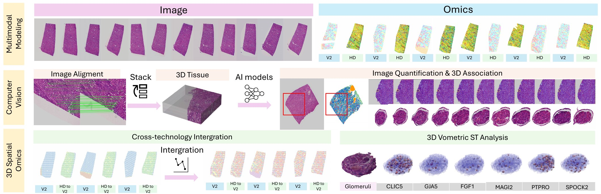

# THiRST: Computer Vision Empowered Three-Dimensional High-Resolution Spatial Transcriptomics Analytics

THiRST reconstructs **3D, multi-resolution spatial transcriptomics (ST)** from conventional serial
2D sections. Whole-slide images (WSIs) and ST measurements from 10x Genomics **Visium V2** (55 µm spots)
and **Visium HD** (8 µm bins) are brought into one 3D coordinate system with morphology-guided
coarse-to-fine registration; ST units are matched across sections; segmented renal structures
(e.g. glomeruli) are linked through depth into 3D objects; and expression is aggregated per 3D object.



*Overview of THiRST (Fig. 1 of the paper): serial histology and multi-platform ST are integrated into a
unified 3D representation.*

---

## Pipeline

| Stage | What it does | Paper | Scripts |
|---|---|---|---|
| 0 | Crop the analysed tissue region of every WSI (4× downsample) and express every Visium V2 spot / HD bin in that frame | — | [`scripts/0_preprocessing`](scripts/0_preprocessing) |
| 1 | **Coarse-to-fine registration**: XFeat affine initialisation → ANTs refinement for every adjacent section pair, affines chained to the middle section; then the same on local 2 × 2 mm patch stacks centred on sampled ST spots (affine at both levels, see [limitations](#status-scope-and-known-limitations)) | Methods 4.1.1–4.1.4 (ISBI Sec. 2.1) | [`scripts/1_registration`](scripts/1_registration) |
| 2 | **3D coordinate transfer** of ST unit centres/polygons and segmented objects, global chain + nearest-patch refinement | Methods 4.1.5–4.1.6, Alg. 1–2 | [`scripts/2_coordinate_transfer`](scripts/2_coordinate_transfer) |
| 3 | **ST unit association**: IoU between V2 spots of all section pairs and between V2 spots and HD bins (distance-pruned, parallel) | Methods 4.1.7, Alg. 4 (ISBI Sec. 2.2) | [`scripts/3_st_association`](scripts/3_st_association) |
| 4 | **3D object reconstruction**: same-class IoU tracking of objects across sections — Hungarian assignment (`track_objects.py`) or greedy best IoU (`track_objects_greedy.py`) — export to QuPath, morphometry | Methods 4.2.5 (ISBI Sec. 2.3); the Hungarian procedure is that of Alg. 3 | [`scripts/4_object_tracking`](scripts/4_object_tracking) |
| 5 | **Object-level ST**: ST units inside every 3D object, per-object barcodes for 2D-vs-3D differential expression, 3D gene maps, cell-type annotations | Results 2.2 (ISBI Fig. 3) | [`scripts/5_object_analysis`](scripts/5_object_analysis) |
| 6 | Figures and quality control (checkerboards, 3D renderings, sampling QC) | — | [`scripts/6_visualization`](scripts/6_visualization) |

Segmentation, the Seurat integration and the expression statistics of the paper are not part of this
release (see [Status, scope and known limitations](#status-scope-and-known-limitations)). Every script
documents its inputs, outputs and original file name in its header (`python <script> --help`);
[`docs/PIPELINE.md`](docs/PIPELINE.md) describes the data layout and every step in detail.

## Repository layout

```
THiRST/
├── configs/example.yaml        # one YAML file per tissue block: paths, Space Ranger outputs, names
├── thirst/                     # small shared library (config, ANTs wrapper, transform and table checks)
├── scripts/
│   ├── 0_preprocessing/        # export_st_centers.py, export_st_contours.py
│   ├── 1_registration/         # xfeat_affine.py, affine_to_itk.py, ants_affine.py, warp_to_reference.py,
│   │                           # sample_patch_centers.py, crop_patch_stacks.py
│   ├── 2_coordinate_transfer/  # global_* and patch_* for spot centres, spot polygons and objects
│   ├── 3_st_association/       # v2_v2_iou.py, v2_hd_iou.py, merge_v2_hd_iou.py
│   ├── 4_object_tracking/      # track_objects.py (+ greedy variant), check_track_counts.py, cross_section_area.py
│   ├── 5_object_analysis/      # match_objects_to_spots.py, export_track_barcodes.py, gene maps, QuPath cells
│   └── 6_visualization/        # checkerboard.py, tracking_figure.py, render_3d_objects.py, qc_spot_sampling.py
├── demo/                       # synthetic exemplar dataset + end-to-end run with ground-truth check
├── tests/                      # pytest cases for the failure modes listed under "known limitations"
├── segmentation/  integration/ # placeholders for the components listed above
└── docs/                       # PIPELINE.md (data layout, step-by-step I/O), PROVENANCE.md (code history)
```

## Installation

```bash
git clone https://github.com/hrlblab/THiRST.git
cd THiRST
conda env create -f environment.yml      # or: pip install -r requirements.txt  (Python >= 3.9)
conda activate thirst
```

Two external tools are required for registration:

* **ANTs** (`antsRegistrationSyN.sh`, `ConvertImagePixelType`) — install from the
  [ANTs releases](https://github.com/ANTsX/ANTs/releases) or with `conda install -c conda-forge ants`
  (tested with ANTs 2.6.5) and set `paths.ants_bin` in the config (or export `ANTSPATH`, or put the
  binaries on `PATH`).
* **XFeat** is loaded through `torch.hub` from `verlab/accelerated_features` at the commit set in the
  config (`xfeat_hub`), which needs internet access on first use (or point `xfeat_hub` at a local
  clone). A GPU is optional.

OpenSlide is installed by pip through `openslide-bin`; with an older `openslide-python` install the
system library instead (e.g. `apt install libopenslide0`).

## Quick start: synthetic demo (≈5 min on a CPU)

```bash
bash demo/run_demo.sh                     # creates demo_data/, runs stages 0-5, checks the result
bash demo/run_demo.sh --real              # same with XFeat and ANTs, in demo_data_real/
```

With `--real` the demo runs for several hours on a 2-core CPU: ANTs (`antsRegistrationSyN.sh`) takes
about 10 minutes per full-size section pair there.

The demo builds a 12-section block (V2 and HD alternating) with known section-to-section transforms
and six glomerulus-like objects, runs the whole pipeline and verifies that registration recovers the
transforms, that all objects are reconstructed with the correct number of sections, and that V2 spots
are matched across sections. By default XFeat/ANTs are replaced by the ground-truth transforms; with
`--real` they estimate the registration. The two modes always use separate directories, because the
registration steps reuse results that already exist.

The simulated global registration is deliberately off by a known small rotation and shift per
section, and the simulated patch-level transforms are the exact local corrections, so the check
confirms both that the global stage leaves the expected residual and that patch-level refinement
removes it. With `--real` the check also confirms that XFeat and ANTs actually ran for every pair.

To run the tests (about 30 s, no GPU or ANTs needed): `pip install pytest && python -m pytest tests`.

## Running on your data

1. **Prepare the inputs** (layout and naming in [`docs/PIPELINE.md`](docs/PIPELINE.md)):
   WSIs named `<case>-<section>.svs` (pyramid level 2 = 4× downsample); a QuPath GeoJSON per WSI with the
   tissue region (class `normal`, configurable); Space Ranger `tissue_positions` for every section;
   and, for the object analyses, the QA'd Omni-Seg segmentation as `<case>-<section>.svs.geojson`.
2. **Write a config**: copy [`configs/example.yaml`](configs/example.yaml) and fill in the paths and the
   `st_sections` table.
3. **Run the stages in order** (all commands from the repository root):

```bash
CFG=configs/my_block.yaml

# 0 | sections and ST units in the 4x frame
python scripts/0_preprocessing/export_st_centers.py  --config $CFG --save-png
python scripts/0_preprocessing/export_st_contours.py --config $CFG

# 1 | global registration (adjacent pairs -> middle section)
python scripts/1_registration/xfeat_affine.py      --config $CFG --level global
python scripts/1_registration/affine_to_itk.py     --config $CFG --level global
python scripts/1_registration/ants_affine.py       --config $CFG --level global
python scripts/1_registration/warp_to_reference.py --config $CFG --level global

# 2 | transfer ST units and objects with the global chain
python scripts/2_coordinate_transfer/global_spot_centers.py  --config $CFG
python scripts/2_coordinate_transfer/global_spot_contours.py --config $CFG
python scripts/2_coordinate_transfer/global_objects.py       --config $CFG

# 1 | patch-level refinement: sample patch centres, crop patch stacks, register them
python scripts/1_registration/sample_patch_centers.py --config $CFG
python scripts/1_registration/crop_patch_stacks.py    --config $CFG
python scripts/1_registration/xfeat_affine.py      --config $CFG --level patch
python scripts/1_registration/affine_to_itk.py     --config $CFG --level patch
python scripts/1_registration/ants_affine.py       --config $CFG --level patch
python scripts/1_registration/warp_to_reference.py --config $CFG --level patch

# 2 | refine every ST unit / object with its nearest patch
python scripts/2_coordinate_transfer/patch_spot_centers.py  --config $CFG
python scripts/2_coordinate_transfer/patch_spot_contours.py --config $CFG
python scripts/2_coordinate_transfer/patch_objects.py       --config $CFG

# 3 | ST unit correspondences (repeat with --registration global and none to compare registration stages)
python scripts/3_st_association/v2_v2_iou.py       --config $CFG --registration patch
python scripts/3_st_association/v2_hd_iou.py       --config $CFG --registration patch
python scripts/3_st_association/merge_v2_hd_iou.py --config $CFG --registration patch

# 4 | 3D objects (add --min-track-len 10 to keep only objects seen on >= 10 sections)
python scripts/4_object_tracking/track_objects.py      --config $CFG
python scripts/4_object_tracking/check_track_counts.py --config $CFG

# 5 | object-level ST
python scripts/5_object_analysis/match_objects_to_spots.py --config $CFG
python scripts/5_object_analysis/export_track_barcodes.py  --config $CFG
```

`track_objects.py --min-track-len 10` writes its tracks as `IoU_Object_longglom.json`; pass
`--tracks-suffix _longglom` to the stage 4–6 scripts to use them (their outputs then carry the same
suffix, so the results for all tracks and for long tracks are kept apart).

The ANTs and IoU steps are the slow ones; `ants_affine.py` skips pairs that are already registered
(`--overwrite` recomputes them) and `v2_hd_iou.py` skips finished batches, so both can be restarted.
A step that cannot produce complete results stops with an error, so do not continue after a failed
step: `xfeat_affine.py` and `ants_affine.py` list the pairs that failed (XFeat writes the status of
every pair to `registration_xfeat/xfeat_status.csv`, including pairs that fell back to an identity
initialisation), and the transfer scripts check that every transform of the chain exists and is
readable before they write anything. A restart of `ants_affine.py` skips only pairs that it completed
successfully (`ants_completed.json`), never the output of a failed or interrupted run.

`torch.hub` by itself pins neither XFeat's code nor its weights, so `configs/example.yaml` sets both
(the release configuration): `xfeat_hub: verlab/accelerated_features:<commit>` (or the path of a local
clone) and `xfeat_weights_sha256`, which stops the run if the weights differ. Keep
`<image_root>/xfeat_provenance_<level>.json`, which records the commit and the SHA-256 of the code and
of the weights. The XFeat revision used for the published results was not recorded. For the calls
THiRST makes, every revision of XFeat from its release (April 2024) to the pinned commit runs the same
code with the same default weights file (see *XFeat version* in [`docs/PROVENANCE.md`](docs/PROVENANCE.md));
which weights the published runs used can only be shown by the `checkpoints/xfeat.pt` of the torch.hub
cache on the machine that ran them (compare its SHA-256 with `xfeat_weights_sha256`). On first use
torch.hub asks whether to trust the repository; answer once in an interactive terminal (or use a local
clone). The remaining analysis and figure scripts are listed in [`docs/PIPELINE.md`](docs/PIPELINE.md).

### Main outputs

| File | Content |
|---|---|
| `<image_root>/<case>/registration_3D_ANTs/image_*.png` | sections registered to the middle section |
| `<point_root>/<case>/registration_3D_patch_ANTs/image_*_center.csv` | every ST unit in the common 3D frame (patch-refined) |
| `<contour_root>/<case>/IoU_patchreg/row_<i>_col_<j>.json` | V2 spot correspondences between sections *i* and *j* |
| `<contour_root>/<case>/IoU_ST_to_HD_distance_patchreg_merge/row_<i>_col_<j>.json` | V2 spot ↔ HD bin overlaps |
| `<contour_root>/<case>/Object_IoU_patch_connectglom/IoU_Object.json` | 3D objects (one track per object) |
| `<contour_root>/<case>/Object_IoU_patch_connectglom/WSI_tracking_geojson/` | 3D objects as QuPath annotations on every WSI |
| `.../Object_tracking_IoU_affine_patch_gene_barcode_connectglom/glomeruli_barcode_per_slice.json` | HD barcodes of every 3D object, per section |

## Status, scope and known limitations

THiRST is research code released with the manuscripts. Before applying it to new data:

* **What has been verified.** `tests/` (55 tests) builds small inputs for every failure mode found in
  review — failed, missing or unreadable registrations, restarts after a failed ANTs run, empty
  sections, small HD regions, units without coordinates, misaligned or reordered tables, a wrong
  section layout, objects of different classes, filtered and empty track files, Space Ranger HD
  barcodes, XFeat provenance, mixed demo modes — and checks that each gives the correct result or a
  clear error. The [demo](demo) runs stages 0–5 on a synthetic block with
  known transforms, including a known global-registration residual that the patch level must remove;
  variants with sections numbered 2–13, with small HD regions, and with stand-ins for XFeat and ANTs
  pass as well. [`docs/PROVENANCE.md`](docs/PROVENANCE.md) shows that on valid synthetic input the
  scripts reproduce the outputs of the original lab scripts. That agreement shows that the
  reorganisation preserved their behaviour, not that the methods are correct in every situation. The
  demo has not yet been run to completion with the actual XFeat and ANTs (`--real`); real tissue data
  and the biological results of the paper were not re-run.
* **Registration is affine where it is applied.** `ants_affine.py` runs `antsRegistrationSyN.sh -t s`
  (rigid + affine + SyN), but every script that maps images, ST units or objects uses only the affine
  part (`output0GenericAffine.mat`); the SyN warp fields are written and never applied. The patch-level
  refinement is therefore piecewise affine: each ST unit or object follows the affine chain of its
  nearest patch stack.
* **Section layout and classes.** Stage 3 and the object-level scripts of stages 5–6 assume that Visium
  V2 and Visium HD sections alternate, starting with V2 (as in the paper); they check `st_sections` and
  stop otherwise. Objects are only linked to objects of the same class; stages 5–6 support one object
  class (`object_classes: [capsule]` in the paper).
* **Remaining edge cases.** Objects cannot be linked across a section that has no object, so their
  tracks restart after it (the tracker names such sections). Objects that extend beyond the window of
  their nearest patch stack are not refined and are left out of the patch-level object files
  (`patch_objects.py` reports how many per section).
* **Not included.** Omni-Seg segmentation (Methods 4.2.1–4.2.4, [`segmentation/`](segmentation)); the
  Seurat CCA integration of V2 and HD (Methods 4.3, [`integration/`](integration)); and the analyses
  built on this pipeline's outputs: consecutive-section Hungarian trajectories of ST units (Methods
  4.1.7, Alg. 3; ISBI Sec. 2.2 — stage 3 writes the IoU tables they start from), HD→V2 aggregation
  (ISBI Eq. 4), cluster concordance C(d) and expression correlation R(d) (ISBI Eqs. 5–6, Results 2.4),
  the volumetric morphology–cluster IoU (ISBI Sec. 2.3), the overlap-weighted object expression of
  ISBI Eq. 7 (`export_track_barcodes.py` lists the HD bins whose four corners lie inside an object,
  without weights), and the 2D-versus-3D differential expression (Results 2.2). The numerical results of
  the paper cannot be regenerated from this repository alone.

## Citation

If you use THiRST, please cite:

```bibtex
@inproceedings{zhu2027thirst,
  title     = {{THiRST}: Computer Vision Empowered Three-Dimensional High-Resolution Spatial Transcriptomics Analytics},
  author    = {Zhu, Junchao and Wang, Yu and Lu, Zhengyi and Qu, Chongyu and Zhu, Yanfan and Yang, Yuechen and
               Zhao, Shilin and Yang, Haichun and Huo, Yuankai and Deng, Ruining},
  booktitle = {IEEE International Symposium on Biomedical Imaging (ISBI)},
  year      = {2027}
}
```

*(Citation details will be updated upon publication.)*

THiRST builds on Map3D (registration-based tracking on serial WSIs) and Omni-Seg (renal segmentation):

```bibtex
@article{deng2021map3d,
  title   = {Map3D: registration-based multi-object tracking on 3D serial whole slide images},
  author  = {Deng, Ruining and Yang, Haichun and Jha, Aadarsh and Lu, Yuzhe and Chu, Peng and Fogo, Agnes B and Huo, Yuankai},
  journal = {IEEE Transactions on Medical Imaging}, volume = {40}, number = {7}, pages = {1924--1933}, year = {2021}
}
@article{deng2023omniseg,
  title   = {Omni-Seg: A scale-aware dynamic network for renal pathological image segmentation},
  author  = {Deng, Ruining and Liu, Quan and Cui, Can and Yao, Tianyuan and Long, Jun and Asad, Zuhayr and Womick, R Michael and
             Zhu, Zheyu and Fogo, Agnes B and Zhao, Shilin and others},
  journal = {IEEE Transactions on Biomedical Engineering}, volume = {70}, number = {9}, pages = {2636--2644}, year = {2023}
}
```

## Acknowledgments

This work was supported by the National Institutes of Health (R01DK135597) and the U.S. National
Science Foundation (Award 2434229). Registration uses [XFeat](https://github.com/verlab/accelerated_features)
and [ANTs](https://github.com/ANTsX/ANTs); WSIs are read with [OpenSlide](https://openslide.org).

## License

Released under the GNU General Public License v2.0 — see [LICENSE](LICENSE). Third-party tools
(XFeat, ANTs, OpenSlide) are distributed under their own licenses.
